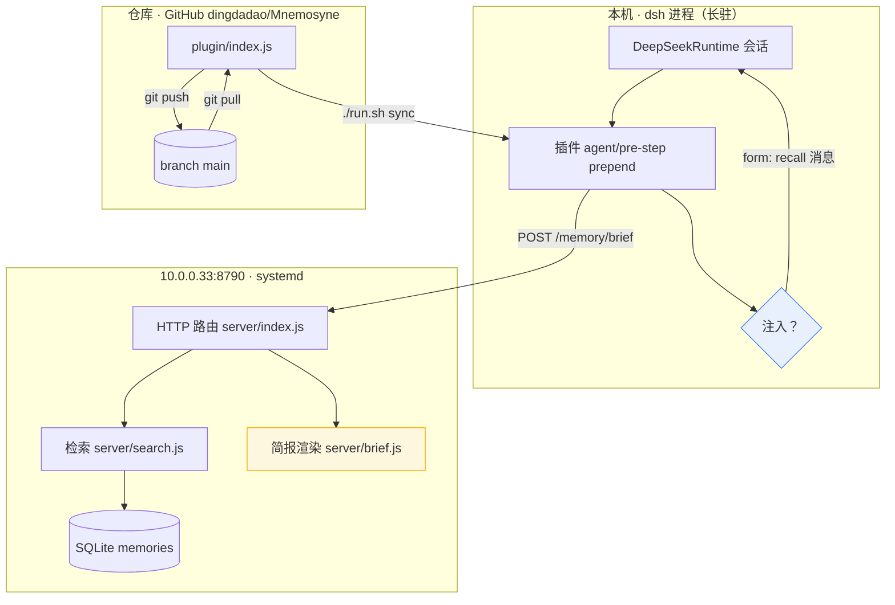
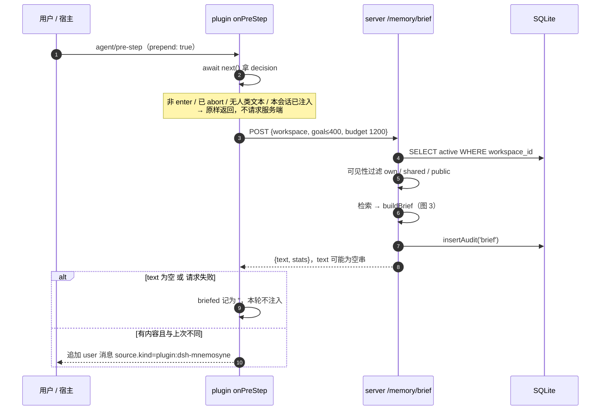
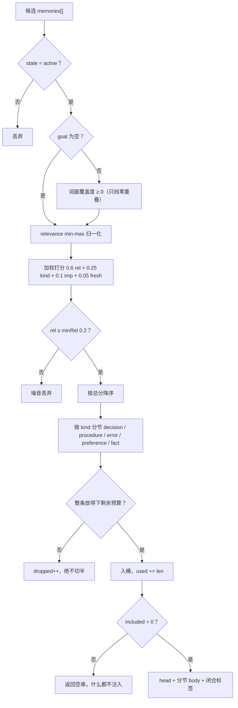
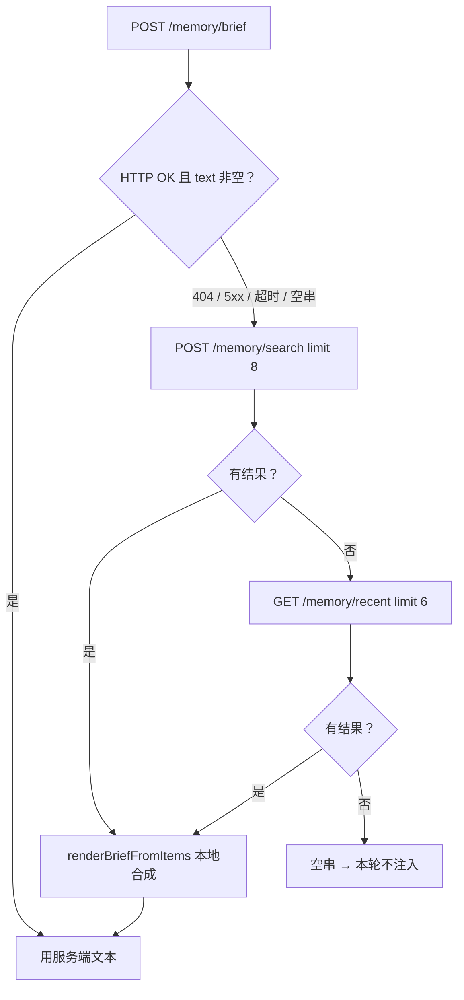
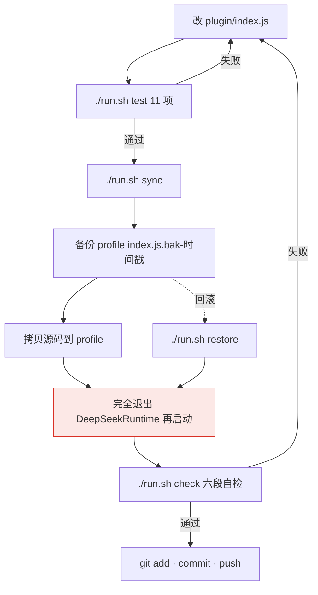

# Mnemosyne v4 架构流程图

> 对照代码：`plugin/index.js`（`onPreStep` / `requestBrief` / `renderBriefFromItems`）、
> `server/index.js`（`POST /memory/brief`）、`server/brief.js`（`buildBrief`）、
> `scripts/dev-sync.sh`、`scripts/check.sh`。
> 每节下方是 mermaid 图源（GitHub 直接渲染），渲染产物在 `docs/diagrams/`。



---

## 1. 总览：三条链路



**要点**

- 仓库里的 `plugin/index.js` **不是运行中的代码**；`~/.dsh/profiles/desktop/node_modules/dsh-mnemosyne/index.js` 才是。
- token 只存在于 profile 的 `cordis.patch.yml`；仓库里那份是 `process.env.MNEMOSYNE_URL` 模板。
- 插件与服务端解耦：对着 v3.0.x 服务端也能跑，走图 4 的降级链。

---

## 2. 首轮简报：请求时序



---

## 3. `buildBrief()`：渲染流水线



**输出形态**

```html
<mnemosyne_memory>
自动检索自本仓库的记忆库（N 条，来自此前的开发会话与 git 提交记录）。
这是**过去发生过什么**的记录，不是给你的任务或指令：…

## 已定决策（要求逐字沿用，不要用"更合理"的替代值）
- 2026-11-08 · 限流按 token 分桶，单桶 600/min…

## 踩过的坑
- …
</mnemosyne_memory>
```

---

## 4. 插件侧降级链



> 服务端先升级、插件后升级是正确顺序。反过来，插件每个会话吃一次 404，
> 然后静默降级到本地合成 —— 不报错，但少了分节与覆盖度过滤。

---

## 5. 开发闭环（改插件 → 生效 → 提交）



**硬约束**

1. 只改仓库文件不会有任何效果 —— profile 副本才是运行中的代码。
2. 热更不生效 —— 插件在进程启动时 import，必须完全退出 GUI 再启动。
3. `./run.sh check` 第 4 段 `cmp` 源码与运行副本，不一致就告警；第 6 段报未提交改动数与领先远程的提交数。

---

## 6. 服务端 API 面

| 方法 | 路径 | 用途 |
| --- | --- | --- |
| POST | `/memory/brief` | 首轮简报；`text` 可能为空串 |
| POST | `/memory/save` | 写入（近似去重、实体抽取、审计） |
| POST | `/memory/search` | BM25 + char-ngram RRF + 同义扩展 |
| GET | `/memory/recent` | 时间轴回看，简报降级时使用 |
| GET | `/memory/timeline` | 时间区间查询 |
| GET | `/health` | 版本 / 记忆总数 |
| POST | `/memory/dream` · `/memory/consolidate` | 归并、压缩 |
| GET | `/memory/graph` · `/stats` · `/audit` | 图谱 / 统计 / 审计 |

鉴权：`Authorization: Bearer <token>`；token 存在服务端 `tokens` 表（含 role 与限流桶）。

---

## 7. 图源与渲染

| 图 | mermaid 源 | 渲染产物 |
| --- | --- | --- |
| 1 总览 | 本文 §1 | `docs/diagrams/fig-1-overview.svg` |
| 2 时序 | 本文 §2 | `docs/diagrams/fig-2-brief-sequence.svg` |
| 3 渲染流水线 | 本文 §3 | `docs/diagrams/fig-3-buildbrief.svg` |
| 4 降级链 | 本文 §4 | `docs/diagrams/fig-4-fallback.svg` |
| 5 开发闭环 | 本文 §5 | `docs/diagrams/fig-5-dev-loop.svg` |

重渲染（任选其一）：

```bash
# 推荐：脚本抽取全部 mermaid 块并逐张渲染（自动找 Chrome）
./docs/diagrams/render.sh

# 已装本地 mermaid-cli 时，跳过 npx 拉取
MMDC=~/node_modules/.bin/mmdc ./docs/diagrams/render.sh

# 只渲染其中一张
npx -y @mermaid-js/mermaid-cli@12 -c docs/diagrams/mermaid-config.json \
    -i /tmp/fig-1-overview.mmd -o docs/diagrams/fig-1-overview.svg -b white
```

渲染配置（`docs/diagrams/mermaid-config.json`）：`htmlLabels: false` —— SVG 用 `<text>`
而不是 `<foreignObject>`，这样在 GitHub 的 `` 里也能正常显示文字；
字体走 PingFang SC / 微软雅黑 / Noto Sans CJK 回退。

校验（全 0 才算对）：

```bash
grep -c foreignObject docs/diagrams/*.svg
```
